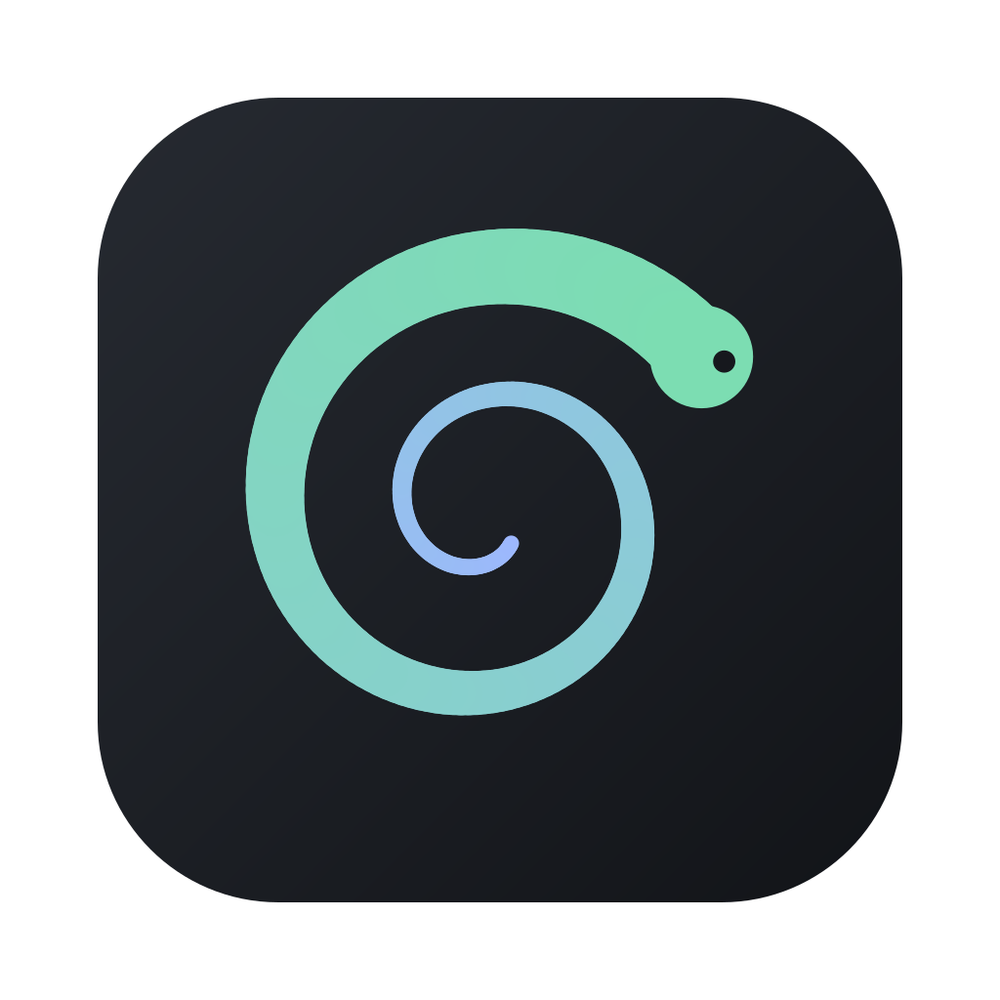

<p align="center">
  
</p>

<h1 align="center">earworm</h1>

<p align="center"><b>Playlist in, library out.</b></p>

<p align="center">
  Paste a YouTube playlist. Get back a folder of audio files with checked
  tags, cover art and an <code>.m3u8</code> that any player can open.
</p>

## Two ways to run it

earworm comes as a **desktop app** and a **terminal app**. They share one
library, one config and the same keys, so you can switch between them at
any point. Both need three tools first:

```sh
brew install yt-dlp ffmpeg chromaprint      # or your package manager's equivalents
```

### Desktop app

For when you want covers in front of you. Your library is shown as album
sleeves, a run fills in track by track, and the common actions have buttons as
well as keys. It runs on macOS (Apple Silicon) and Linux.


Download the `.dmg`, AppImage or `.deb` from the
[latest release](https://github.com/madebygrant/earworm/releases/latest), or
build it from a clone with `scripts/install-desktop.sh`. The Mac app isn't
signed, so macOS stops it once on first launch.
[Here's how to get past that](docs/install.md#first-launch-on-macos). The
[desktop guide](docs/gui.md) goes through it screen by screen.

### Terminal app

For when you live in a terminal, or work over SSH. Everything is on the
keyboard, and it can run unattended in a script.


```sh
cargo install --git https://github.com/madebygrant/earworm --tag v1.0.0

earworm                                            # open the app
earworm 'https://youtube.com/playlist?list=...'    # or go straight to a playlist
```

[Every key](docs/keys.md) has a page. For scripts, `--list` and `--check`
answer in plain text, and [configuration](docs/configuration.md) covers every
flag.

## Why earworm

yt-dlp gets you audio files. earworm turns them into a music library.

- **Tags it can back up.** Every track is checked against AcoustID
  fingerprints, Deezer and Apple Music. If earworm isn't sure, it says so
  instead of guessing.
- **Cover art that fits.** Embedded and capped at 1000×1000, not
  YouTube's 2048² thumbnails. Albums get one sleeve, playlists a mosaic.
- **Sync again, download only what's new.** Re-runs fetch the new tracks,
  list the ones that left the playlist, and skip what's already on disk.
- **Fix anything later, offline.** Edit tags, search your whole library,
  rename folders. Folders you copied in yourself work too.
- **Then listen.** Play through [cliamp](https://docs.cliamp.stream),
  build custom playlists, or export to a USB stick or SD card.
- **Find what you're missing.** Browse your artists, see which of their
  albums you own, and hear about new releases.

[Features](docs/features.md) has the full list and the details.

## How a run goes

1. Give earworm a link.
2. It lists the playlist and asks which tracks you want. Enter takes them
   all, and `space` and `/` pick out the rest. You'll want this the first
   time a playlist turns out to be 361 tracks of seminar recordings.
3. It downloads, identifies, tags, adds art, names the files and writes the
   `.m3u8`.
4. Anything it couldn't confirm is marked for a look. `v` shows just those.

## Learn more

| Start here | |
| --- | --- |
| [Installing](docs/install.md) | tools, the AcoustID key, `--check` |
| [Features](docs/features.md) | everything earworm does, in detail |
| [Workflow](docs/workflow.md) | picks, filters, fixing tags, retry |
| [Desktop app](docs/gui.md) | the window, screen by screen |
| [Keys](docs/keys.md) | every key in both apps, and what the status words mean |

| Going deeper | |
| --- | --- |
| [Configuration](docs/configuration.md) | the config file and every flag |
| [Library](docs/library.md) | the library screen, search, export, `--resync` |
| [Formats](docs/formats.md) | m4a, opus, mp3, flac, and what converts |
| [Chapters](docs/chapters.md) | cutting an album upload into tracks |
| [Loudness](docs/loudness.md) and [lyrics](docs/lyrics.md) | ReplayGain, R128 and LRCLIB |
| [Artists](docs/discovery.md) | stars, discographies, new releases |
| [Playback](docs/playback.md) | playing through cliamp |
| [Themes](docs/themes.md) | five palettes and your own |
| [Internals](docs/internals.md) | how tagging decides, what gets written |

## Who it's for

Anyone who has downloaded a playlist and then renamed the files by hand.
earworm never deletes a file you didn't ask it to.

## Licence

MIT or Apache-2.0, at your option.
